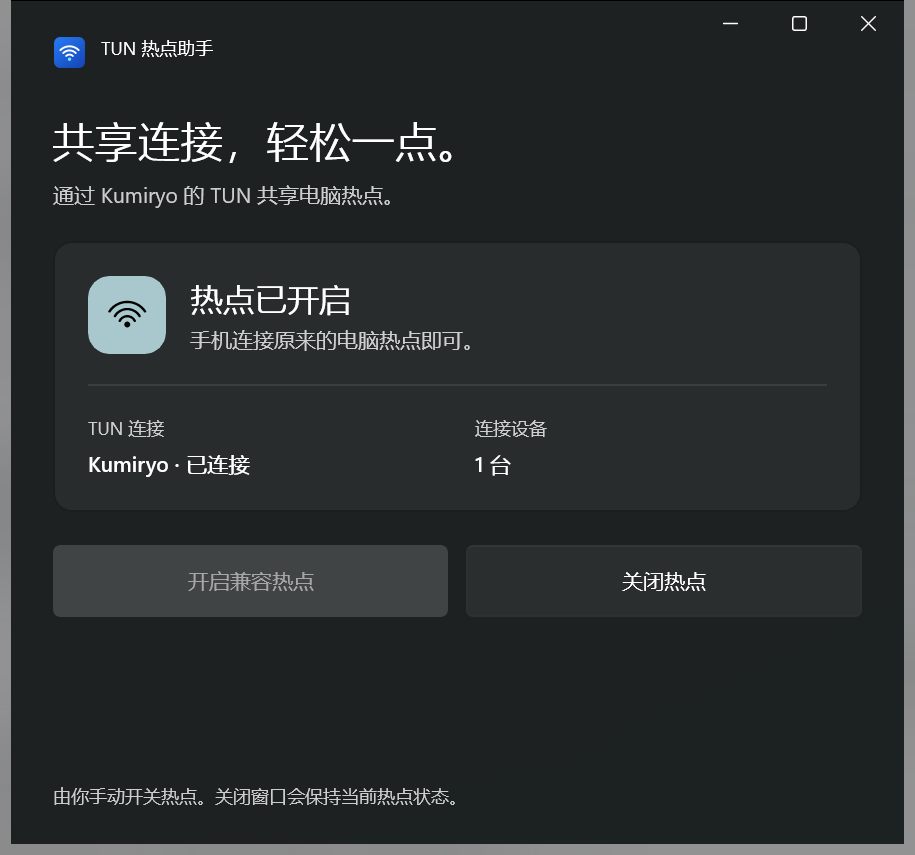

# TUN 热点助手

原生 C# / WinUI 3 小工具，让 Windows 移动热点使用当前 Kumiryo TUN 连接共享网络。适用于普通 Windows 热点与 Kumiryo TUN 同开后，电脑或手机断网的已验证场景。


当前版本 **1.0.1 · Windows x64**。本项目位于 `D:\project\winUI\TunHotspot`，源代码、构建工具缓存、便携软件和安装包均在此目录内。Visual Studio、Windows SDK 和系统 .NET SDK 继续由各自安装器管理。

## 直接使用

便携版入口为 `artifacts\win-x64\TunHotspot.exe`，桌面的“TUN 热点助手”快捷方式指向该程序。保留整个 `win-x64` 目录，不能只取走 exe。

1. 在 Kumiryo 中手动开启 TUN。
2. 打开助手，点击“开启兼容热点”。
3. 手机连接电脑原来的热点。界面会显示热点状态、TUN 状态和已连接设备数量。
4. 不用时点击“关闭热点”；准备关闭 TUN 时先关闭热点。



启动、刷新和关闭助手窗口会保留当前热点状态。程序只在用户点击按钮时开关热点，不重启 Kumiryo，也不改订阅、分流规则、DNS、防火墙、热点名称或密码。软件没有添加开机启动项。

## 安装与卸载

安装包：`artifacts\installer\TunHotspot-1.0.1-Setup-x64.exe`。

双击安装包，选择目录后安装。默认安装到当前用户的 `%LOCALAPPDATA%\Programs\TunHotspot`，也可以选择 D 盘其他目录；默认创建桌面及开始菜单入口。安装包包含 .NET 与 WinUI 运行库，使用者不需要安装 Visual Studio。

通过 Windows“设置 → 应用 → 已安装的应用 → TUN 热点助手”卸载。安装和卸载都不会自动开关热点。更新/卸载前需手动关闭助手窗口，Kumiryo 可以继续运行；操作日志默认保留。

本地制作的应用和安装包尚未做代码签名。随包提供 `.sha256` 校验文件；安装包不会关闭 SmartScreen。

## 开发与构建

开发环境：Windows、.NET 10 或更高 SDK、Windows SDK 10.0.26100、WinUI 3 开发组件。应用目标为 .NET 10、Windows SDK 26100，最低声明支持 Windows 10 19041；实际热点功能目前只在本机 Windows 11 / Kumiryo 环境验收。

使用 Visual Studio 打开 `TunHotspot.slnx`，选择 x64。也可以在项目根目录运行：

```powershell
# 发布便携版。会进行 NuGet 还原。
.\build.ps1 -Publish

# 使用本机已迁入的完整依赖缓存离线发布。
.\build.ps1 -Publish -Offline

# 重新生成原创 ICO / PNG 图标。
.\tools\Generate-Icon.ps1

# 准备便携 Inno Setup 7 编译器，仅首次需要。
.\tools\Initialize-InstallerTools.ps1

# 将已发布目录打成安装包，输出 SHA-256。
.\tools\Build-Installer.ps1
```

首次从纯源码复制项目时，`.tools` 不包含在版本控制内，需要联网还原 NuGet 依赖并初始化安装编译器。已有的本地缓存已随项目迁移，可直接使用。

## 目录

```text
TunHotspot/
├─ TunHotspot.slnx                 Visual Studio 解决方案
├─ README.md / CHANGELOG.md        使用入口与版本记录
├─ build.ps1 / NuGet.Config        构建、发布与依赖源
├─ src/TunHotspot.WinUI/           C#、XAML、manifest、Assets 图标
├─ installer/TunHotspot.iss        安装/卸载、快捷方式及运行检测
├─ tools/                         图标生成与安装包构建脚本
├─ docs/                          开发说明、操作说明、验收与历史
├─ artifacts/win-x64/             可直接运行的完整便携软件
├─ artifacts/installer/           安装程序与 SHA-256 校验文件
├─ artifacts/qa/                  截图、文件迁移校验及安装验证证据
└─ .tools/                        NuGet 缓存及便携安装编译器，不随软件分发
```

详见 [开发说明](docs/DEVELOPMENT.md)、[验收记录](docs/VALIDATION.md)、[常见问题](docs/TROUBLESHOOTING.md) 与 [第三方组件](docs/THIRD-PARTY-NOTICES.md)。`docs/history` 是本机问题排查的历史记录，当前使用入口以本 README 为准。
