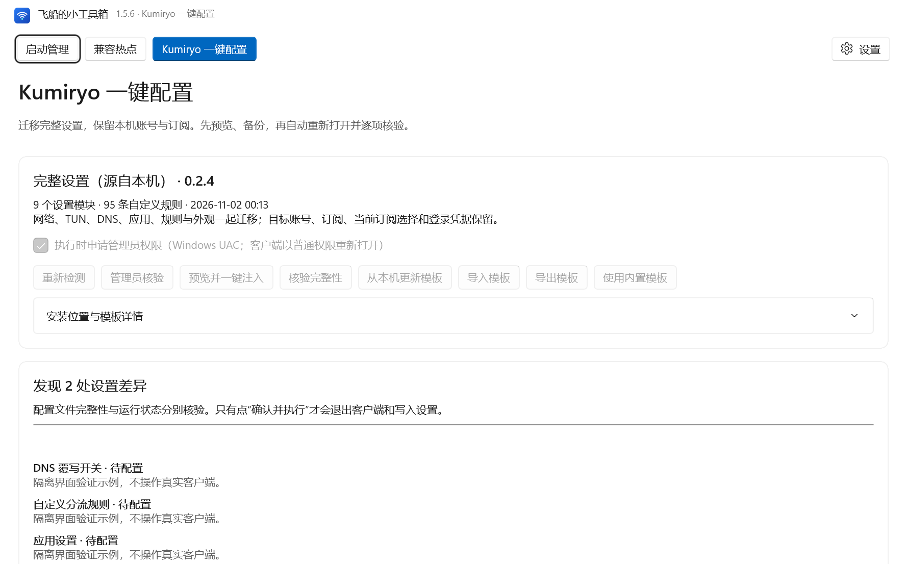

# 飞船的小工具箱 · FeiChuan Toolbox

当前版本 **1.5.6** · Windows 11 x64 · WinUI 3 / .NET 10

[](https://github.com/lizhengyi3003/FeiChuan-Toolbox/actions/workflows/ci.yml)
[](https://github.com/lizhengyi3003/FeiChuan-Toolbox/releases/latest)
[](LICENSE)

把启动管理、兼容热点和 Kumiryo 一键配置放在同一个 Windows 工具箱中。界面使用 WinUI 3，各工作区独立，全局设置和日志不依赖启动管理数据库。

A Windows 11 desktop toolbox for startup inspection and guarded controls, hotspot sharing, and backed-up Kumiryo configuration migration. Optional Codex integration analyzes queued evidence; normal operation does not require Codex or an API key.

## 下载与安装

从 [GitHub Releases](https://github.com/lizhengyi3003/FeiChuan-Toolbox/releases/latest) 获取安装器或完整便携 ZIP。发布包包含 .NET、WinUI 和 app-local VC++ 运行文件，使用者无需安装 SDK、Visual Studio 或开发工具。只复制单个 exe 无法运行。

- 支持 Windows 11 **x64**；最低声明 22000，已做干净系统验证的构建为 26100。其他构建和硬件仍须实测。
- 安装默认为当前用户；受保护目录、机器组件和系统修改按需申请 UAC。升级会协调本目录进程、备份、替换、逐文件核验，并在失败时保留恢复入口。
- 当前二进制**未做 Authenticode 签名**。发布页提供 `SHA256SUMS.txt`、同提交源码、依赖 SBOM 和 GitHub 构建证明；这些不等于 Windows 代码签名。
- Release 附 WinGet/Scoop 清单供审核和本地使用；目前不代表已上架社区源、Microsoft Store 或 NuGet。

下载后用 `Get-FileHash -Algorithm SHA256 <文件路径>` 与 `SHA256SUMS.txt` 对照。安装、迁移和恢复见 [使用说明](docs/guides/使用说明.txt)、[故障排查](docs/TROUBLESHOOTING.md)；构建证明验证见 [发布维护](docs/RELEASING.md)。

## 功能与边界

| 工作区 | 能力 |
| --- | --- |
| 启动管理 | 登录入口、服务/驱动、计划任务、打包应用、系统间接入口、扩展、WMI 和进程快照；管理员全局扫描、进度、持续观察、偏离通知、历史与恢复记录 |
| 单项控制 | 支持范围内启用/禁用、服务启停和启动类型；操作预览、授权、备份、指纹复核和实际回读；不自动争抢其他软件改回的配置 |
| 分析与来源 | 未分析项自动入队，分类和应用视图，Codex/DSH 来源分组；可选 Codex MCP 或文件交换，分析结果不能执行任意系统命令 |
| 兼容热点 | 手动开关、设备数、真实状态、隔离工作进程、稳定观察和有限重试；效果受网卡、驱动、TUN 和上游网络影响 |
| Kumiryo 配置 | 0.2.4 的九模块、95 条自定义规则；预览、DPAPI 备份、独立事务、经授权的界面退出兜底、普通权限重开、逐项核验和冲突保护恢复 |
| 全局设置 | Acrylic、Mica、MicaAlt、None，主题、系统字体、登录自启、托盘与系统通知；日志按类别、等级、时间和关键词筛选 |

管理员权限不意味着可以绕过 Windows、受保护服务或安全软件。文件设置完整和全部运行效果已生效分别核验；客户端没有提供的内核读回能力会标明待核对。当前证据和限制见 [验收记录](docs/VALIDATION.md)。



上图为隔离 QA 示例，使用模拟数据，不代表真实用户扫描结果。

## 数据与安全

用户数据在 `%USERPROFILE%\.FeiChuanToolbox`，机器组件数据在受控 `%ProgramData%\TunHotspot`。账号、订阅和登录凭据不随通用模板迁移；DPAPI 原始备份通常只能在原电脑原用户上下文恢复。日志在本地保存，不自动上传。

报告问题前检查命令参数、路径、图片和日志是否包含私人信息。普通问题使用 [Issues](https://github.com/lizhengyi3003/FeiChuan-Toolbox/issues/new/choose)，安全漏洞通过 [私密报告](https://github.com/lizhengyi3003/FeiChuan-Toolbox/security/advisories/new)。详见 [安全策略](SECURITY.md)、[安全审查](docs/SECURITY-REVIEW.md)。

## 开发与工程

安装 `global.json` 指定的稳定版 .NET SDK、PowerShell 7、Windows SDK 26100 和 C++/WinUI 构建组件。默认依赖源仅为公共 NuGet；包版本集中管理，六个工程的依赖锁文件提交入库。

```powershell
git clone https://github.com/lizhengyi3003/FeiChuan-Toolbox.git
cd FeiChuan-Toolbox
./test.ps1
./build.ps1
./tools/security/Test-Workflows.ps1
./tools/security/Test-Secrets.ps1 -History
./tools/security/Test-Dependencies.ps1
```

```text
src/          WinUI、Core、Engine 产品工程
tests/        功能检查和隔离客户端夹具
tools/        构建、测试、安全与维护入口
installer/    安装器及升级协调
docs/         架构、指南、版本化 Wiki 和脱敏报告
.github/      CI/CD、依赖更新、评审与问题模板
artifacts/    本地构建、日志与备份，全部忽略，不上传源码仓库
```

产品版本只在 `Directory.Build.props` 维护，依赖版本在 `Directory.Packages.props`，SDK 在 `global.json`。协议、数据库和夹具版本独立维护。完整打包统一输出 `artifacts/current`；正式公开包由受控 `vX.Y.Z` 标签工作流生成，不上传本机开发目录。

参与开发请读 [贡献规范](CONTRIBUTING.md)、[架构](docs/ARCHITECTURE.md)、[开发说明](docs/DEVELOPMENT.md) 和 [文档导航](docs/README.md)。[Wiki](https://github.com/lizhengyi3003/FeiChuan-Toolbox/wiki) 的版本化源文件位于 [docs/wiki](docs/wiki/Home.md)。

## 许可证

项目自有源码使用 [GNU GPL v3.0 only](LICENSE)。第三方依赖、微软运行时和开发工具保留各自许可，见 [第三方声明](docs/THIRD-PARTY-NOTICES.md)。分发衍生作品时请遵守对应许可证及源码提供要求。
