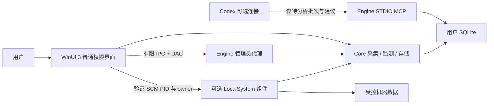

# 架构与文件职责

当前产品版本 1.5.6；当前产物布局以 Artifacts.ps1 和 PROJECT-STRUCTURE.md 为准，历史构建不参与编译或分发。

三个产品工程与功能检查的编译依赖为 WinUI → Core、Engine → Core、Tests → Core；隔离集成夹具也依赖 Core，模拟客户端独立编译。Core 不引用 WinUI 或 Engine；它使用 Windows 注册表、SCM、WMI 等接口，并非跨平台库。

目录树与放置规则见 [工程目录](PROJECT-STRUCTURE.md)；文档入口见 [文档导航](README.md)。目录表示功能归属，既有类型、协议和持久化身份保持兼容。

## 模块映射

| 层 | 主要文件 | 职责 |
| --- | --- | --- |
| 应用与主窗口 | WinUI/App.xaml.cs、WinUI/Shell/ | 单实例、主窗口初始化、导航、生命周期 |
| 功能页面 | WinUI/Features/Startup、Hotspot、Configuration、Settings | 页面构建、用户交互、进度、预览与操作协调 |
| UI 辅助 | WinUI/Controls、Infrastructure | 共用布局、权限客户端、托盘、通知、故障窗口及日志适配 |
| 配置迁移 | Core/Configuration/Kumiryo | 无凭据模板、九模块合并、预检、事务、客户端核对、普通令牌重开、独立观察和恢复 |
| 私有文件与身份 | Core/Security | 实际路径、进程身份、DPAPI 私有文件及原子写入 |
| 扫描与观测 | Core/Startup/Scanning、Monitoring | 统一扫描编排、各来源读取、文件检查、覆盖记录、持续监测 |
| 模型与建议 | Core/Startup/Models、Analysis、Control | 扫描与监测模型、分析指纹、查询、来源标记和控制策略 |
| 数据 | Core/Storage | SQLite、完整性核验、热事务回滚、备份恢复及旧库迁移 |
| 全局设置与诊断 | Core/Settings、Diagnostics | 独立偏好、自己的登录启动、分类诊断日志 |
| 热点与网络 | Core/Hotspot、Networking | 隔离热点进程、稳定观察、有限重试、网络只读诊断及受限修复 |
| 协议 | Core/Contracts | 版本、严格序列化、有类型有限 IPC |
| 引擎入口与复核 | Engine/Program.cs、Auditing | 模式分派、单次 UAC、两轮只读复核 |
| 机器组件 | Engine/Installation、Monitoring | 受控版本安装、目录权限、SCM 生命周期、授权 owner、后台采集 |
| 安装与更新 | installer/Upgrade-Coordinator.ps1、Core/Installation | 安装器权限与进程协调、程序文件备份与恢复、更新期间启动拦截 |
| 实际控制 | Engine/StartupControl | 重读核对、备份、有限单项修改、回读、恢复 |
| AI 桥接 | Engine/Mcp | 只读队列/证据、合法建议回写，无系统控制或任意命令接口 |
| 验证 | tests/、tools/test/ | 功能检查、隔离夹具、协议边界、WinUI 自动化和沙盒验证 |

## 操作和数据边界

扫描：普通 UI 调用 Core 读取可访问范围；全局扫描请求 UAC 代理，或使用已安装且通过身份核对的机器组件。取消扫描不替换完整基线。读取失败保留历史并标记，不能推定条目已删除。

修改：用户选择 → WinUI 预览 → UAC → 管理员代理重读与指纹核对 → 受控备份 → 允许范围内单项操作 → 系统回读 → 本地记录。模型建议不进入这条链路，不自动覆盖其他软件之后的写入。

分析：未知或失效条目自动入队 → 最多 100 项本机批次 → 可选 Codex/文件交换 → 严格字段、本机、批次及当前指纹校验 → 更新建议。用途影响分析适用性；来源标记单独保存。名称、路径或作者仅为线索，确认来源必须记录依据。

Kumiryo 设置：用户预览 → 独立工作进程（可经 UAC）→ 发起 SID/本机/目录边界核对 → 按目标配置加独占锁 → DPAPI 备份 → 退出经身份核对的客户端 UI → 稳定文件复读 → 原子合并 → 普通令牌重开 → 文件和运行分开核验。管理员模式仅处理当前账户标准目录，拒绝其他账户提权及任意目标写入。管理员只读预检单独返回无凭据差异。观察进程等待同一个已核实的工作进程，异常退出后进行有冲突保护的恢复；不停止 Kumiryo 服务或内核。命令入口仅接受本机账户私有目录中的操作编号，不进入启动管理 MCP、管理员单项控制或机器服务协议。

配置迁移不依赖启动数据库。当前用户目录 `KumiryoConfiguration/operations/<编号>` 保存请求、脱敏状态及 DPAPI 原始/目标副本；原始凭据不会放入明文操作日志或通用分发包。配置模板作为 Core 的资源随同分发。

用户数据、统一诊断和配置迁移记录在 `%USERPROFILE%/.FeiChuanToolbox`；原 AppData 目录保留供迁移与核验，兼容操作日志仍写 `%LOCALAPPDATA%/TunHotspot.WinUI`。机器程序在 %ProgramFiles%/TunHotspot/Monitor，机器数据在 %ProgramData%/TunHotspot/Monitor，操作原始备份在 %ProgramData%/TunHotspot/Actions。受控备份不随便携包迁移。

## 配置与文档的依据

全局外观、窗口、托盘与通知由 Core `PreferencesStore` 独立保存在 `preferences.json`，首次可从健康数据库迁移，并保留上一份有效副本。WinUI 顶部全局设置使用独立内容区，不受启动库故障页拦截。

`DiagnosticLog` 保存独立诊断 JSON（错误编号、版本、时间、错误码、详情和重试边界），过滤常见凭据；主目录失败时尝试当前用户受限的临时目录。页面读取失败显示 WinUI 兜底页，重试只重新读取；启停与注入不自动重复执行。初始化失败仍进入诊断窗口。可恢复的数据异常与不可保证安全继续的进程级故障分别处理，后者仅尽力留档。

`ToolboxStore` 使用无连接池的短连接，每个连接持有共享维护租约；离线修复持有同一文件的排他锁，因此新连接会收到维护提示。修复必须先停止当前用户的界面和分析进程、验证残留文件锁，并成套备份数据库及旁文件，再原子替换通过完整性和模型检查的候选。不能把提取成功视为全部历史完整恢复。

通用私有文件写入先写完并刷盘。已存在的 EFS 或路径映射文件核对实际父目录、保留原访问规则与加密要求，再通过禁止跨卷复制的重命名替换。实际文件不在同一目录、加密未继承或权限不能保留时停止，不用普通复制冒充原子更新。产品按运行机器动态解析路径，未写入本机 D 盘缓存位置。

| 内容 | 维护入口 | 使用方式 |
| --- | --- | --- |
| 产品版本、目标框架 | Directory.Build.props | 产品工程和功能检查继承；服务/MCP/组件从程序集取版本，安装器从此读取；模拟客户端版本单独声明 |
| 依赖版本 | Directory.Packages.props | 各项目仅声明 PackageReference；发布后依据 deps/runtimeconfig/Notices 核对 |
| 协议、数据库和规则版本 | Contracts/Contract.cs、Storage/ToolboxStore.cs、Startup/Analysis/Classifier.cs | 独立兼容性边界，不随产品版本机械递增 |
| 用户功能范围 | README.md、docs/guides/使用说明.txt | 当前行为与限制；使用说明随包分发 |
| 架构与构建 | 本文件、DEVELOPMENT.md | 文件职责、开发和打包入口 |
| 验证结论 | VALIDATION.md、启动管理-能力与验证.md | 关联有日期的本机证据，区分历史和当前 |
| 发布身份 | 包内 release.json、files.sha256，包旁 release-版本.json | 关联提交、版本及安装/便携包校验值 |

主窗口各页面仍使用 WinUI 3 控件，由按功能拆分的 partial 文件构建；没有宣称已迁移为 MVVM。WindowsScanner 的统一编排与各来源实现已分别存放，尚未引入插件动态装载。后续扩展继续遵守现有协议、权限和数据边界。

## 稳定性与故障边界

`UserDataMigration` 使用 SQLite 在线备份迁移健康旧库，不移动仍可能被旧进程打开的数据库；损坏旧库不自动变成空库。固定的当前用户目录避开从打包宿主启动时的 AppData 虚拟化差异。UI、MCP 和管理员工作进程均用同一 DataPaths。连接解析实际目录、关闭连接池，使用 DELETE 日志与 FULL 刷盘。

`DatabaseRecovery` 只恢复最近的完整性/结构核验有效备份。持有排他维护锁，保留替换前原件；非空 WAL/回滚旁日志、文件仍占用、加密属性不匹配均阻止自动恢复。用户必须预览确认，健康数据库不提供覆盖恢复。

`HotspotWorkerClient` 启动本软件受控 Engine 子进程，只接受 read/start/stop/keepalive；工作进程核对父 PID、启动时刻、会话及账户。WinRT 热点对象保留在工作进程，网络变化不再由 UI 中的 WinRT 回调释放对象。原生故障、超时或管道结束只使热点操作失败；读取可稍后重试，写操作不会自动重放。API 返回成功后还要稳定观察五秒。此保护不能保证 Windows、Wi-Fi 驱动或上游 TUN 永远不关闭热点。

`StartupRegistration` 独立于启动数据库控制当前账户的工具箱 Run 和 StartupApproved 同名值。预览指纹、原值备份、实际回读和失败恢复都限制在自己的入口；机器采集服务另行控制。

统一 `DiagnosticLog` 包含类别、严重等级、时间、版本、PID、编号、错误码及脱敏详情。AppLog、扫描故障、配置迁移步骤、热点隔离故障及权限操作均接入；备用目录按数据根隔离。WinUI LogViewer 读取内存快照后筛选，避免每按一个搜索字符都重复扫描磁盘；刷新只读取，不重做系统操作。

`NetworkHealth` 仅探测固定的商店公开端点，显式说明不使用 HTTP 代理仍可能经过 TUN。清除代理只在当前用户配置恰为 127.0.0.1、端口未监听、没有 PAC、Kumiryo TUN 未连接且预览指纹一致时可执行；保留其他网络配置。缓存修复由用户确认后启动 Windows wsreset，不宣称启动工具即等于商店业务恢复。

异常关机后的 SQLite 776（READONLY_ROLLBACK）单独处理：先排他维护并归档 .db/回滚日志/旁文件，再允许 SQLite 原生事务恢复。未提交的修改回滚后，仍须通过只读完整性和版本检查才进入应用写入。真实损坏、其他只读原因或未来结构不会由此重置。
