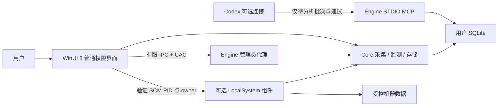

# 架构与文件职责

四个项目的编译依赖为 WinUI → Core、Engine → Core、Tests → Core。Core 不引用 WinUI 或 Engine；它使用 Windows 注册表、SCM、WMI 等接口，并非跨平台库。

## 模块映射

| 层 | 主要文件 | 职责 |
| --- | --- | --- |
| 应用与主窗口 | App.xaml.cs、ToolboxWindow.xaml/.cs | 单实例、路由、列表、进度、预览与操作协调 |
| UI 辅助 | TrayIcon.cs、TrayMenuWindow.cs、NotificationBridge.cs、FontCatalog.cs、FlowPanel.cs | 系统托盘接口、WinUI 菜单、通知、字体枚举与布局 |
| 热点页面 | HotspotPage.xaml/.cs、HotspotService.cs、AppLog.cs | 用户按钮触发热点 API、只读状态刷新、操作日志 |
| 扫描与观测 | WindowsScanner.cs、CommandInspector.cs、OfflineHive.cs、LiveMonitor.cs、RegistryChangeWatch.cs | 配置读取、目标解析、覆盖说明、持续监测 |
| 数据与查询 | Models.cs、ToolboxStore.cs、EntryQueries.cs、CreationOrigins.cs | 数据模型、分析指纹、SQLite、独立筛选、来源证据 |
| 权限与协议 | Wire.cs、ProcessSecurity.cs、ControlModels.cs | 有类型 IPC、实际连接进程核对、操作预览与记录 |
| 引擎入口 | Program.cs、ReadOnlyAudit.cs | 模式分派、单次 UAC、两轮只读复核 |
| 机器组件 | ComponentInstaller.cs、MonitorService.cs | 受控版本安装、SCM 生命周期、授权 owner、后台采集 |
| 实际控制 | ControlExecutor.cs | 重读核对、备份、有限单项修改、回读、恢复 |
| AI 桥接 | McpServer.cs | 只读队列/证据、合法建议回写，无系统控制或任意命令接口 |
| 验证 | TunHotspot.Tests/Program.cs、tools/Test-*.ps1 | 核心功能、协议边界、WinUI 自动化、隔离系统控制与分发验证 |

## 操作和数据边界

扫描：普通 UI 调用 Core 读取可访问范围；全局扫描请求 UAC 代理，或使用已安装且通过身份核对的机器组件。取消扫描不替换完整基线。读取失败保留历史并标记，不能推定条目已删除。

修改：用户选择 → WinUI 预览 → UAC → 管理员代理重读与指纹核对 → 受控备份 → 允许范围内单项操作 → 系统回读 → 本地记录。模型建议不进入这条链路，不自动覆盖其他软件之后的写入。

分析：未知或失效条目自动入队 → 最多 100 项本机批次 → 可选 Codex/文件交换 → 严格字段、本机、批次及当前指纹校验 → 更新建议。用途影响分析适用性；来源标记单独保存。名称、路径或作者仅为线索，确认来源必须记录依据。

用户数据在 %LOCALAPPDATA%/TunHotspot.Toolbox；热点日志在 %LOCALAPPDATA%/TunHotspot.WinUI。机器程序在 %ProgramFiles%/TunHotspot/Monitor，机器数据在 %ProgramData%/TunHotspot/Monitor，操作原始备份在 %ProgramData%/TunHotspot/Actions。受控备份不随便携包迁移。

## 配置与文档的依据

| 内容 | 维护入口 | 使用方式 |
| --- | --- | --- |
| 产品版本、目标框架 | Directory.Build.props | 四个项目继承；服务/MCP/组件从程序集取版本，安装器从此读取 |
| 依赖版本 | 各项目 PackageReference | 发布后依据 deps/runtimeconfig/Notices 核对 |
| 协议、数据库和规则版本 | Models.cs、ToolboxStore.cs、CommandInspector.cs | 独立兼容性边界，不随产品版本机械递增 |
| 用户功能范围 | README.md、docs/使用说明.txt | 当前行为与限制；使用说明随包分发 |
| 架构与构建 | 本文件、DEVELOPMENT.md | 文件职责、开发和打包入口 |
| 验证结论 | VALIDATION.md、启动管理-能力与验证.md | 关联有日期的本机证据，区分历史和当前 |
| 发布身份 | 包内 release.json、files.sha256，包旁 release-版本.json | 关联提交、版本及安装/便携包校验值 |

目前主窗口仍通过代码构建各页面，WindowsScanner 仍集中编排多个提供程序；现有实现已分层，并未完成全面 MVVM 或插件化重构。后续增加复杂页面或扫描源时可继续按页面、提供程序拆分，保持协议和权限边界。
